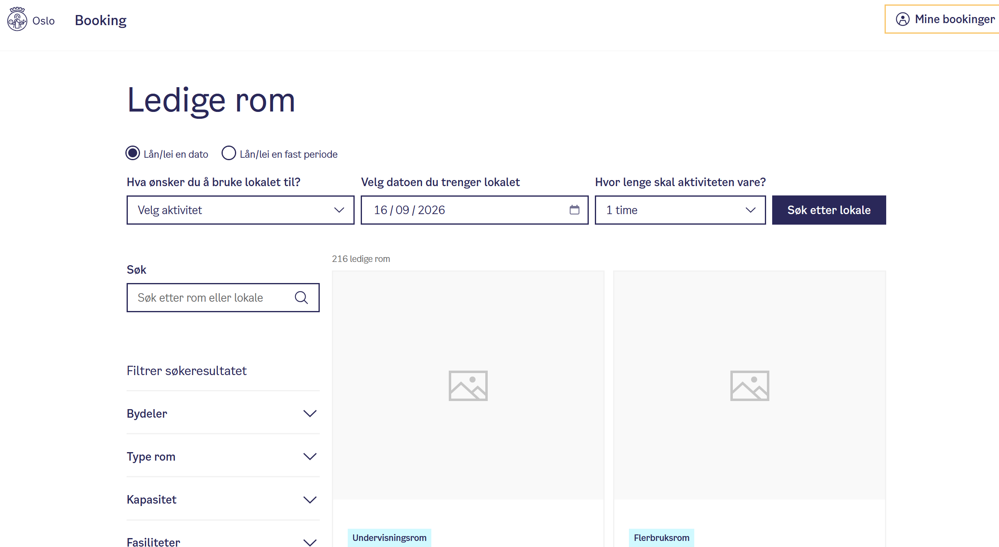

# TheBooking – booking av studierom

Gruppeprosjekt i ITPE3200 Webapplikasjoner (OsloMet, høst 2026), oppgave 1: *Study Room Booking Tool*.
Studenter kan finne og booke studierom, opprette studieøkter, og la andre studenter bli med.

Prosjektet består av to selvstendige delapplikasjoner:

| | Mappe | Teknologi | Adresse |
|---|---|---|---|
| **Subapp 1** | `src/thebooking/` | ASP.NET Core MVC (.NET 10), EF Core + SQLite, Identity | `http://localhost:5190` |
| **Subapp 2** | `subapp2/` | ASP.NET Core Web API (.NET 10) + React 19/Vite/TypeScript | API `http://localhost:5234`, React `http://localhost:4000` |

## Forutsetninger
- [.NET 10 SDK](https://dotnet.microsoft.com/download) – sjekk med `dotnet --version`
- [Node.js](https://nodejs.org/) 20.19+ eller 22.12+ (kreves av Vite) – kun for Subapp 2, sjekk med `node --version`

Databasen (SQLite, `Booking.db`) opprettes automatisk ved første oppstart. Man trenger ikke kjøre `dotnet ef database update`.

## Kjøre Subapp 1 (MVC)
```
cd src/thebooking
dotnet run
```
Åpne `http://localhost:5190`. (`dotnet watch` fungerer også, og laster siden på nytt når koden endres.)

Ved oppstart kjøres migrasjonene, roller (Admin, Manager, User) og admin-kontoen opprettes, og i Development legges det inn testdata: bygg, rom, utstyr, studenter og studieøkter.

### Testbrukere (Subapp 1)
| Rolle | E-post | Passord |
|---|---|---|
| Admin | `admin@oslomet.no` | `Admin123!` |
| Student (User) | `student1@oslomet.no` | `Student123!` |
| Student (User) | `student2@oslomet.no` | `Student123!` |

Admin-kontoen settes i `src/thebooking/appsettings.json` (`AdminAccount`). Man kan også registrere en ny bruker, som får rollen User.

### Roller og tilgang
| Rolle | Hva rollen kan |
|---|---|
| Ikke innlogget | Se forsiden og rom, registrere seg og logge inn |
| User | Lage, endre og slette egne bookinger, bli med på / forlate åpne studieøkter, sende meldinger i økter man er med i |
| Admin | Alt User kan, i tillegg: administrere bygg, utstyr og rom, og se alle bookinger |

Rollen Manager opprettes av `RoleSeeder`, men brukes ikke av noen controller ennå. Private studieøkter kan bare åpnes av eieren, deltakerne og admin.

## Kjøre Subapp 2 (API + React)
```
cd subapp2/thebooking-react
npm install        # bare første gang
npm run dev
```
`npm run dev` starter både API-et og React-appen. Åpne `http://localhost:4000`. API-et kan testes direkte i Scalar på `http://localhost:5234/scalar/v1`.

Se [subapp2/README.md](./subapp2/README.md) for detaljer, alternativ oppstart i to terminaler og feilsøking.

## Kjøre testene
Enhetstestene for Subapp 1 ligger i `src/thebooking.Tests/` (xUnit + NSubstitute). De tester `BookingController`, `RoomController` og `BookingService` med mockede repositorier, så de trenger ingen database.
```
cd src/thebooking.Tests
dotnet test
```
Man kan også kjøre `dotnet test thebooking.slnx` fra rotmappen.

## Prosjektstruktur (Subapp 1)
```
src/thebooking/
├── Controllers/   Tar imot forespørsler og velger view (Account, Booking, Building, Equipment, Home, Message, Room)
├── Models/        Entitetene som blir tabeller i databasen (Room, Booking, Building, ...)
├── ViewModels/    Data som sendes til et bestemt view (i stedet for ViewBag)
├── Views/         Razor-sider (.cshtml), felles layout i Views/Shared/_Layout.cshtml
├── DAL/           BookingDbContext, repositoriene (interface + implementasjon) og DBInit (testdata)
├── Services/      BookingService (forretningsregler: validering av bookinger, hvem som kan bli med i og skrive i en økt)
├── Data/          RoleSeeder og AdminSeeder (roller og admin-konto)
├── Migrations/    EF Core-migrasjoner
├── Logs/          Loggfiler fra Serilog
└── wwwroot/       Statiske filer (CSS, bilder, Bootstrap/jQuery fra LibMan)
```

## Vanlige feil
- **`table "Rooms" already exists`, `no such table`, `FOREIGN KEY constraint failed` eller rare testdata** etter `git pull` eller bytte av branch: den lokale databasen er laget av en annen versjon av koden. Stopp appen og slett den, så lages en ny ved neste oppstart:
  ```
  cd src/thebooking          # eller subapp2/api for Subapp 2
  Remove-Item Booking.db*    # PowerShell (bash: rm Booking.db*)
  ```
- **`address already in use`**: appen kjører allerede i en annen terminal (eller i Rider/VS Code). Stopp den først.
- **Får ikke logget inn som student1/student2**: studentene og resten av testdataene legges bare inn når appen kjører i Development (`ASPNETCORE_ENVIRONMENT=Development`, som er satt i `Properties/launchSettings.json`). Admin-kontoen opprettes alltid.
- **Får ikke logget inn som admin**: sjekk om du har satt `AdminAccount:Password` i user secrets (`dotnet user-secrets list` i `src/thebooking`). User secrets overstyrer `appsettings.json`. Admin-kontoen lages bare hvis den mangler, så et endret passord i konfigurasjonen endrer ikke en admin som allerede finnes i databasen. Slett `Booking.db*` for å starte på nytt.
- **Siden mangler stil eller jQuery-validering virker ikke**: `wwwroot/lib` mangler. LibMan henter bibliotekene ved `dotnet build`, så kjør en build (krever nett første gang).
- **Advarsel om HTTPS-sertifikat** når du bruker https-profilen (`https://localhost:7108`): kjør `dotnet dev-certs https --trust` én gang, eller bruk http-profilen på port 5190.

## For utviklere
- `dotnet ef` trengs bare for å *lage* nye migrasjoner, ikke for å kjøre appen. Subapp 1 har verktøyet i `src/thebooking/dotnet-tools.json` (`dotnet tool restore`). For Subapp 2: `dotnet tool install --global dotnet-ef`.
- Datalaget (Models, DAL, Services) i Subapp 2 er kopiert fra Subapp 1 og må holdes i synk manuelt. Bevisste forskjeller i API-et: ingen lazy loading (bruker `.Include()` i stedet), og bookinger seedes ikke før Identity/JWT er på plass i API-et.

---

## Notater fra utviklingen
Arbeidsnotater fra gruppa underveis. For oppdatert informasjon om kjøring, se toppen av denne filen.

### Home page og shared view 
Under [thebooking/src/thebooking/Views/shared/_Layout.cshtml](./src/thebooking/Views/Shared/_Layout.cshtml) ligger _layout.cshtml filen. 
Her lagres et felles shared layout, aner ikke hvordan det funker. 
Jeg tror at den setter inn det samme layoutet på alle sidene, og i _Layout.cshtml har den kode som bare viser en vilkårlig view basert på hvilken side man velger.
Men det gir oss hvertfall en navbar som dukker opp på alle de forksjellige sidene av applikasjonen.
Vi har også laget en "Home" page som er default når applikasjonen starter (altså den vises på root directory ```http://localhost:5190``). 

Denne ligger lagret under [thebooking/src/thebooking/Views/Home/Index.cshtml](./src/thebooking/Views/Home/Index.cshtml). Her definers hjemmesiden, den er per nå veldig enkel og tjener ingen funksjon. Men kult uansett? 😁💪

Vi har også implementert en slags felles import fil? Aner ikke hvorfor eller hva fordelene er. 
Såvidt jeg forstår det importerer den felles på alle filene vi lagrer?  
``` 
@using thebooking
@using thebooking.Models
@addTagHelper *, Microsoft.AspNetCore.Mvc.TagHelpers
```
Det var en del ting under denne biten som var litt forvirrende og ikke like enkelt å forklare. 
Se [Demo-ShopMVC-2-HomeView-Navigation.pdf](DemoDokumentasjon/Demo-ShopMVC-2-HomeView-Navigation.pdf) for mer informasjon om enten startsiden, shared views eller imports.

### thebooking.slnx
Kjørt samtaler med AI ift å bygge prosjektstruktur, og den sier at det er kjekt å ha en solution fil (.slnx). 
Den gir prosjektet en slaks oversikt over hvilke løsninger som er implementert, usikker på hvor nødvendig det er for våres prosjekt men vi ser an. 
Legg til forskjellige solution filer med f.eks:

```dotnet sln thebooking.slnx add src/thebooking/thebooking.csproj``` 

Se om løsningen er lagt til filen riktig med: 
```dotnet sln thebooking.slnx list```


### Frontend-notater

Features: 
* Oversikt over rom som er ledige
  * Mulighet for å se romkapasitet
  * Hva slaks type rom det er
* Reserve et rom
* Filtreringsmulighet/Søk (velge bygning, rom, tidspunkt, plasser)
* Se hvilke rombestillinger man har gjort
* Kalender (mulighet for å velge dager/uker/månder)

Grensesnitt å ta inspirasjon fra (Read: Straight up kopier dette)
https://booking.oslo.kommune.no/?loanType=singleLoan&purposes=&date=2026-09-16&datePicker1=2026-09-16&duration=PT1H&searchType=list


### Logging og feilhåndtering

Lagt til logging i ```RoomController```, bruker ```ILogger<RoomController>```.
- ```ILogger<RoomController>``` logger det som skjer i ```RoomController```.
- Serilog er satt opp i ```Program.cs```.
- Logfører til konsollen og [thebooking/src/thebooking/Logs](./src/thebooking/Logs), filene får tidsstempel og dato.

Loggnivå
- ```LogInformation``` brukes for vanlige ting som skjer, for eksempel når Room-tabellen blir åpnet.
- ```LogWarning``` brukes når et rom ikke blir funnet, altså når vi returnerer NotFound().
- ```LogError``` brukes hvis det oppstår en exception.

Feilhåndtering

```try/catch``` rundt ```SaveChangesAsync()``` i ```Create```,```Edit``` og ```Delete```

Feil i databasen blir logget med ```LogError``` Applikasjonen gir feilmelding istedet for å krasje.


### Stock pictures for rooms

room1 - https://www.google.com/imgres?q=meeting%20room%20pictures&imgurl=https%3A%2F%2Fimages.rawpixel.com%2Fimage_800%2FcHJpdmF0ZS9sci9pbWFnZXMvd2Vic2l0ZS8yMDIyLTA1L3Vwd2s2MTg0NjIwMi13aWtpbWVkaWEtaW1hZ2Uta293Yzh4ZGguanBn.jpg&imgrefurl=https%3A%2F%2Fwww.rawpixel.com%2Fsearch%2Fconference%2520room&docid=mm0Xr02X4xIiRM&tbnid=L32jbCMhGlm0aM&vet=12ahUKEwiUuO_w3KKXAxWEIhAIHQHwG9QQnPAOegQISxAA..i&w=800&h=534&hcb=2&ved=2ahUKEwiUuO_w3KKXAxWEIhAIHQHwG9QQnPAOegQISxAA
https://www.rawpixel.com/image/3284690/free-photo-image-office-living-room-interior-design

room2 - https://www.stockvault.net/photo/185428/business-meeting-room

room3 - https://freerangestock.com/photo/132767/empty-conference-room


